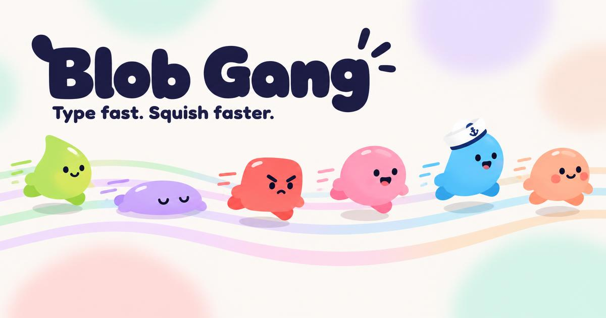
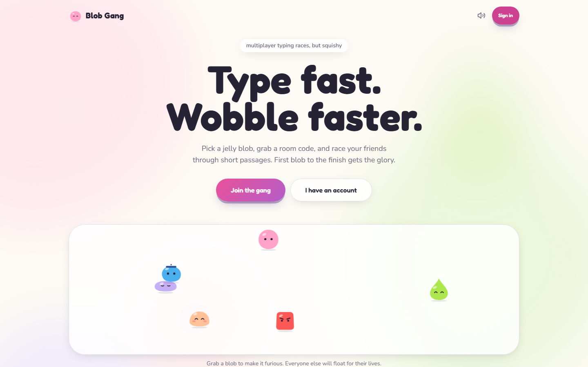
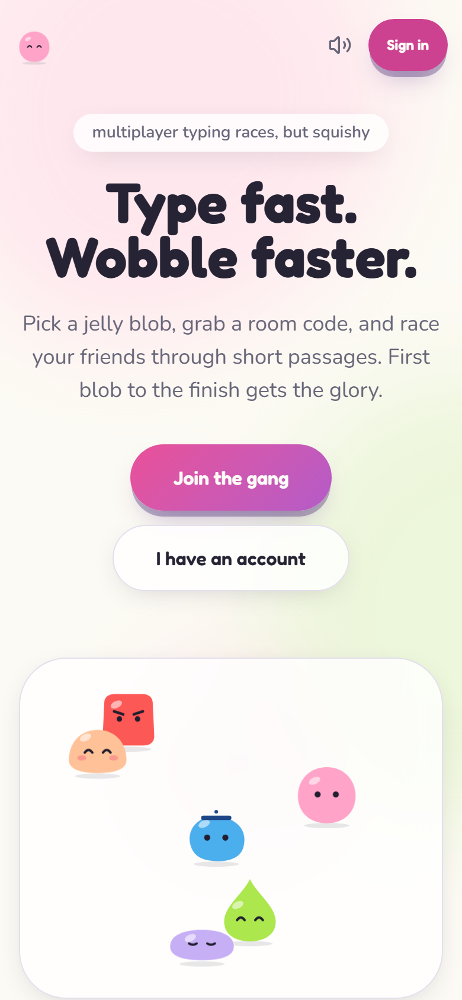
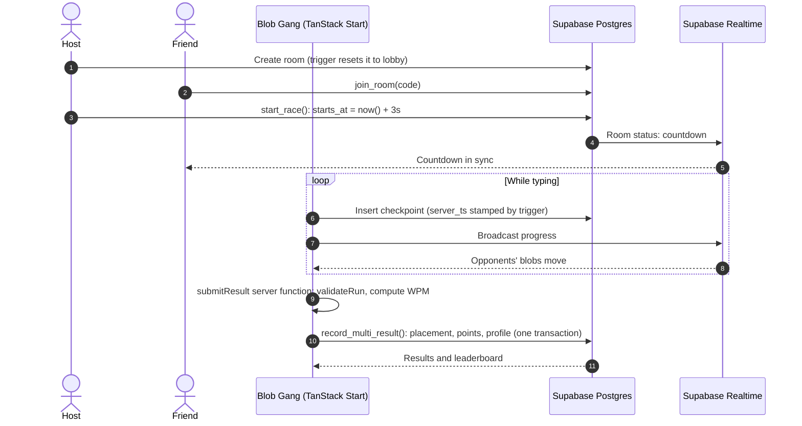

<div align="center">



### A real-time multiplayer typing race game you play in the browser

Pick a jelly blob, share a room code and race your friends through short passages. The first blob to the finish wins.

[**Play now**](https://blobgang.lovable.app) · [Features](#features) · [Fair play](#how-results-are-kept-honest) · [How it works](#how-it-works) · [Tech stack](#tech-stack) · [Run locally](#run-locally)


</div>

<br>

<table>
  <tr>
    <td width="76%" valign="top"></td>
    <td width="24%" valign="top"></td>
  </tr>
  <tr>
    <td align="center"><sub>Desktop</sub></td>
    <td align="center"><sub>Mobile</sub></td>
  </tr>
</table>

## What Blob Gang is

**Blob Gang** is a free online multiplayer typing game. Each player races as a squishy jelly-blob character. The passage stays clean and readable while the blobs do the wobbling. You can create a room and share its code, race solo against a ghost of a previous run, and climb the leaderboard.

## Features

- **Multiplayer rooms.** Create a race room and share its code, or join a friend's room. You can rematch in one click.
- **Live race progress.** Every player's position syncs over a Supabase Realtime channel, with a 3-second countdown set by the server.
- **Solo mode.** Race against a ghost replay of a previous run.
- **Six original blob characters.** Zippy, Snooze, Grumbo, Bubbles, Captain Gloop and Mochi are all drawn by one reusable SVG component with mood and animation variants.
- **Accounts and profiles.** Sign up with email, claim a unique username and pick a blob. Your profile tracks total points and best WPM.
- **Results and a global leaderboard.** It shows each player's points and best words per minute.
- **Narrator and sound effects.** Both are optional, and you can mute them with one toggle.
- **Mobile-friendly.** The game works on phones, adjusts for the on-screen keyboard and warns you to switch off predictive text.

## How results are kept honest

The typing game assumes the browser can't be trusted:

- **Server time, not client time.** A database trigger stamps every progress checkpoint with server time (`now()`), so changing the device clock can't fake a faster run.
- **Results are calculated on the server.** A TanStack Start server function checks the checkpoint trail (`validateRun`) and then calculates WPM and accuracy from the server's own start and finish times.
- **Finishing is atomic.** One Postgres function (`record_multi_result`) locks the room, assigns placement and writes points, the result row and profile totals in a single transaction. Submitting twice returns the first result.
- **Clients can't write results.** Default grants are revoked. Players can insert their own checkpoints and nothing else that affects scoring.
- **One character at a time.** The input rejects pasted text, autocomplete and predictive-text bursts.

**Scoring:** points = WPM × accuracy ÷ 100, plus a placement bonus of 50, 30, 20 or 10 for the top four in races with two or more players.

## How it works



## Tech stack

| Layer | Technologies |
| :-- | :-- |
| Frontend | React, TypeScript, TanStack Start and Router, Tailwind CSS, Framer Motion |
| Real time | Supabase Realtime channels |
| Backend | Supabase: Auth, Postgres with Row Level Security, SQL functions and triggers |
| Database | 6 Drizzle migrations |
| Quality | Vitest and Testing Library (scoring, routing, password recovery), ESLint, Prettier |

## Run locally

```sh
npm install
npm run dev
```

| Script | What it does |
| :-- | :-- |
| `npm run dev` | Start the dev server |
| `npm run build` | Production build |
| `npm test` | Run the tests |
| `npm run lint` | Lint the project |

The committed `.env` holds only the project's public Supabase URL and publishable key, so a local run connects to the hosted backend. To run it on its own, point those values at your own Supabase project. Never commit service-role keys.

## Project structure

```text
src/
├── routes/                    File-based routes
│   ├── index.tsx              Landing page and blob playpen
│   └── _authenticated/        Home, room, race, results, solo, leaderboard, profile
├── components/
│   ├── blob/Blob.tsx          The blob character component (colours from CSS tokens)
│   └── race/                  Lanes, countdown, typing card, live stats
├── hooks/                     use-room, use-typing, use-narrator
└── lib/
    ├── race.functions.ts      Server functions: result validation and submission
    ├── solo.functions.ts      Solo runs and ghosts
    └── scoring.ts             WPM, accuracy and run validation (tested)
drizzle/migrations/            Schema, RLS, RPCs and anti-cheat triggers
```

`AGENTS.md` records the project's design rules.

## Status

Live and actively developed. No license has been specified yet, so all rights are reserved by the author.

## About the author

Blob Gang is designed and built by **[Rumman Hassan](https://rummanhassan.cv)**, a full-stack developer in Lahore, Pakistan. Rumman builds web apps, ecommerce stores and AI systems for growing businesses.

It was built with AI assistance using [Lovable](https://lovable.dev). Rumman owns the game design, the data model and the anti-cheat rules, and changes made in the Lovable editor are committed to this repository.

[Website](https://rummanhassan.cv) · [GitHub](https://github.com/rummanhassan13) · [LinkedIn](https://www.linkedin.com/in/rummanhassan13) · [Work with me](https://cal.com/rummanbuilds/connect)
